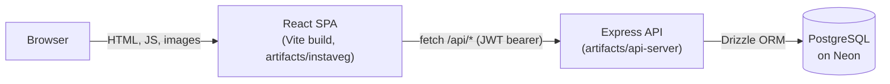

# InstaVEG

**A hyperlocal marketplace where neighbourhood farms sell fresh vegetables, fruits and herbs directly to buyers.**

**Live demo:** coming soon.

## Features

### Buyers
- Browse 8 categories and 32 products, search by name and filter by price
- Product pages with unit, MRP and discount, nutrition info, organic badge and reviews
- Multi-farm cart; checkout splits into one order per farm and shows delivery and platform fees up front
- Cash on delivery: InstaVEG is COD-only by design, so there is no online payment step
- Order history and order status tracking
- Wishlist, saved delivery addresses and profile

### Sellers
- Register a store; products can be listed once an admin approves it
- Add, edit and delete their own products, with stock and pricing validation
- Manage incoming orders, advancing them one step at a time (confirmed, preparing, dispatched, delivered)
- Dashboard with revenue and order statistics, and store settings

### Admins
- Approve or reject seller applications, and suspend or reactivate sellers
- Manage users (suspend or reactivate)
- See all orders and update their status
- Products page with search, edit and delete
- Platform-wide dashboard

## Tech stack

| Area | Technology |
|---|---|
| Monorepo | pnpm workspaces, TypeScript 5.9 |
| Frontend | React 19, Vite 7, Wouter, Zustand, TanStack Query, Tailwind CSS v4, shadcn/ui, Framer Motion, Recharts |
| API | Express 5, Pino logging, JWT auth (bcrypt password hashes), bundled with esbuild |
| Database | PostgreSQL ([Neon](https://neon.tech/)), Drizzle ORM |
| API contract | OpenAPI 3.1 in `lib/api-spec`, generated React Query hooks (`lib/api-client-react`) and Zod schemas (`lib/api-zod`) with Orval |
| Tests | Node's built-in test runner and `fetch` |

## Architecture



In development the Vite dev server proxies `/api` to the API on port 8080, so the browser only talks to one origin.

```
artifacts/
  instaveg/      React frontend (public/images holds the self-hosted product photos)
  api-server/    Express API, mounted at /api; test/ holds the API tests
lib/
  api-spec/      openapi.yaml, the API contract
  api-client-react/, api-zod/   generated from the spec (do not edit src/generated)
  db/            Drizzle schema and database connection
scripts/         seed, verify-images, image-review
docs/            AUDIT.md, ENGINEERING_NOTES.md
```

## Local setup (works on Windows, macOS and Linux)

**Requirements:** Node.js 20 or newer, pnpm 10 (`corepack enable` installs it), and a PostgreSQL database. A free [Neon](https://neon.tech/) project with a separate `dev` branch works well; use its **direct** (non-pooled) connection string.

1. Install dependencies:
   ```bash
   pnpm install
   ```
2. Create `.env` in the repository root from the example (PowerShell: `Copy-Item .env.example .env`; bash: `cp .env.example .env`), then fill in:
   - `DATABASE_URL`: your Neon dev branch connection string.
   - `SESSION_SECRET`: at least 32 random characters, for example from `node -e "console.log(require('crypto').randomBytes(48).toString('base64url'))"`. The API will not start without it.
   - Optional settings (`CORS_ORIGINS`, `AUTH_RATE_LIMIT_MAX`, `AUTH_RATE_LIMIT_WINDOW_MS`, `PORT`) are described in `.env.example`.
3. Create the tables and load the demo data:
   ```bash
   pnpm --filter @workspace/db run push
   pnpm --filter @workspace/scripts run seed
   ```
   The seed is idempotent; running it again resets the demo accounts and the catalog's prices and stock. Only run it against a development database. Locally it also creates the admin account `admin@instaveg.com` with the password `admin123`; the public demo uses a separate, private admin password (see [docs/DEPLOYMENT.md](docs/DEPLOYMENT.md)).
4. Start the API and the frontend in two terminals:
   ```bash
   pnpm --filter @workspace/api-server run dev
   pnpm --filter @workspace/instaveg run dev
   ```
   Open http://localhost:5173. The API listens on http://localhost:8080/api.

   The frontend dev server only accepts connections from this machine. To open it from another device on your network (for example a phone), start it with `DEV_HOST=0.0.0.0` (PowerShell: `$env:DEV_HOST="0.0.0.0"; pnpm --filter @workspace/instaveg run dev`) and browse to your computer's IP address on port 5173.

## Demo accounts

| Role | Email | Password |
|---|---|---|
| Buyer | `buyer@instaveg.com` | `buyer123` |
| Seller (Ramesh Fresh Farm) | `ramesh@instaveg.com` | `seller123` |
| Seller (Priya Organic Greens) | `priya@instaveg.com` | `seller123` |
| Seller (Arjun Exotic Harvest) | `arjun@instaveg.com` | `seller123` |

Admin access to the public demo is available on request.

## Scripts

| Command | What it does |
|---|---|
| `pnpm --filter @workspace/api-server run dev` | Build and start the API on port 8080 using the root `.env` |
| `pnpm --filter @workspace/instaveg run dev` | Start the frontend dev server (proxies `/api` to port 8080) |
| `pnpm --filter @workspace/db run push` | Apply the Drizzle schema to the database in `.env` |
| `pnpm --filter @workspace/scripts run seed` | Load the demo accounts, sellers, categories and products |
| `pnpm --filter @workspace/api-server run test` | Build the API and run all API tests |
| `pnpm --filter @workspace/scripts run verify-images` | Check that every product and category image exists, is unique, is an 800×800 WebP under 150 KB and is credited |
| `pnpm --filter @workspace/scripts run image-review` | Write `tmp/image-review.html`, a visual review page of all images |
| `pnpm --filter @workspace/api-spec run codegen` | Regenerate the API client and Zod schemas after editing `openapi.yaml` |
| `pnpm run typecheck` | Typecheck every package |
| `pnpm run build` | Typecheck, then build every package |
| `pnpm run build:vercel` | Full build, then write the Vercel deployment to `.vercel/output` (see [docs/DEPLOYMENT.md](docs/DEPLOYMENT.md)) |

## Deployment

The app deploys as one Vercel project (static React app plus the API as a Vercel Function in Singapore) with Neon Postgres. [docs/DEPLOYMENT.md](docs/DEPLOYMENT.md) has the step-by-step setup, environment variables, the production schema push and seed, and a smoke-test checklist.

## Testing

The API has 45 automated tests: 22 cover the security fixes (access control on orders and products, order status rules, cash-on-delivery-only payments, the session-secret requirement and address ownership), 16 cover business rules (seller approval, product editing and deletion, review rules and review eligibility, quantity and stock validation, one order per seller with totals equal to the cart total, stock and order-count updates on checkout and cancel, rollback of a failed checkout, and the admin seller list), and 7 cover API hardening (JSON 404s and errors, security headers, login and register rate limits, and CORS).

```bash
pnpm --filter @workspace/api-server run test
```

The tests start the API locally and use the database in `.env`, so point it at a development database. They refuse to run with `NODE_ENV=production` or against a non-local `API_URL`, create their own temporary products and never change the seeded data.

## Security highlights

This codebase went through an audit that fixed, among other things, broken access control on orders and products, forgeable payment verification (the app is now cash-on-delivery only by design), a hardcoded JWT secret fallback, use of other users' addresses at checkout, and checkout pricing and stock bugs. The API also sends security headers, only allows cross-origin requests from origins listed in `CORS_ORIGINS`, and rate-limits failed logins and registrations. See [docs/ENGINEERING_NOTES.md](docs/ENGINEERING_NOTES.md) for the summary and [docs/AUDIT.md](docs/AUDIT.md) for the full audit and open items.

## Image credits

Product and category photos are openly licensed images from Wikimedia Commons. Every image's source, author and license is listed on the in-app [`/credits`](artifacts/instaveg/src/pages/Credits.tsx) page and in [`artifacts/instaveg/public/images/CREDITS.md`](artifacts/instaveg/public/images/CREDITS.md).

## Screenshots

| Home | Product page | Checkout |
|---|---|---|
| _coming soon_ | _coming soon_ | _coming soon_ |

| Seller dashboard | Admin products |
|---|---|
| _coming soon_ | _coming soon_ |

## License

[MIT](LICENSE)
